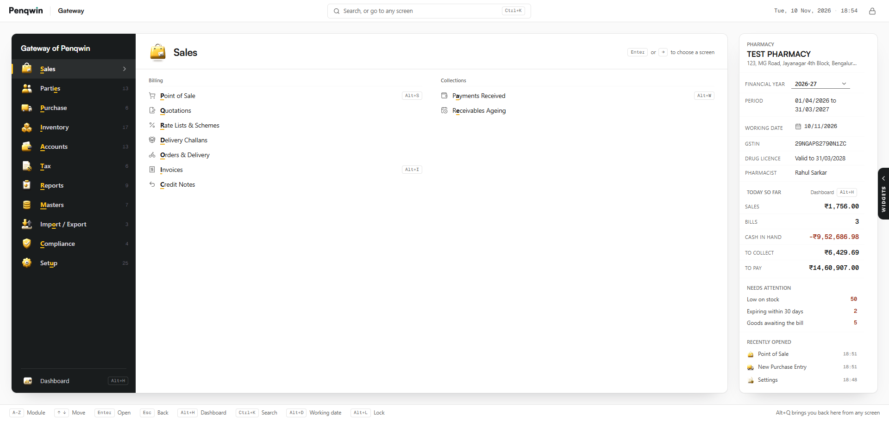

# Penqwin ERP

Pharmacy management software for India. Billing at the counter, stock and batches, purchasing, GST, accounts and reports, in one desktop application. Your records are stored on your own computer.

**[Download the latest release](../../releases/latest)** &nbsp;·&nbsp; Windows, macOS and Linux

  

## At a glance

  

The full list is in [docs/FEATURES.md](docs/FEATURES.md).

## Install

1. From the [latest release](../../releases/latest), grab the file for your computer: `Penqwin-ERP-Windows-6.3.0.exe` on Windows 10/11, `Penqwin-ERP-macOS-6.0.9.dmg` on macOS (Apple Silicon and Intel, one file for both), or on Linux whichever `.deb`/`.tar.gz` matches your distribution — see the release notes for which one that is.
2. Run it and follow the steps. No administrator rights are needed on Windows.
3. Open the app and activate it with your licence.

An existing Penqwin ERP or SARK ERP installation is upgraded in place and keeps its data. Details, requirements and how to verify the download are in [docs/INSTALL.md](docs/INSTALL.md).

## Licence

A licence is per computer. For the price and how to buy, see [penqw.in](https://penqw.in) or write to [hello@penqw.in](mailto:hello@penqw.in).

## Documentation

- [Installing and upgrading](docs/INSTALL.md)
- [Features](docs/FEATURES.md)
- [Changelog](CHANGELOG.md)
- [Support](SUPPORT.md)
- [Security](SECURITY.md)

## Contact

[penqw.in](https://penqw.in) &nbsp;·&nbsp; [hello@penqw.in](mailto:hello@penqw.in)
Whatsapp : 84312 93339
