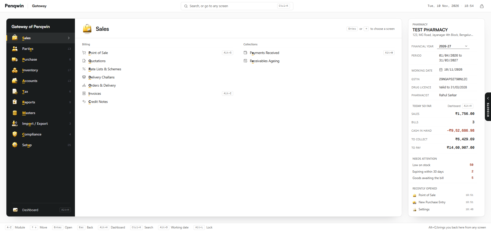

## Penqwin ERP 6.0.9

Pharmacy management software for India. Pick whichever file matches your computer below; an existing Penqwin ERP or SARK ERP install is upgraded in place and keeps its data.

  

### Windows

Works on Windows 10 and 11, 64-bit. No administrator rights needed; just run the installer.

- `Penqwin-ERP-Windows-6.0.9.exe` — 28.0 MB

32-bit Windows isn't built yet.

### macOS

One universal installer for both Apple Silicon (M-series) and Intel Macs, macOS 12 Monterey or newer.

- `Penqwin-ERP-macOS-6.0.9.dmg` — 62.7 MB

The app isn't notarized yet, so the first time you open it, right-click the app and choose Open instead of double-clicking, or Gatekeeper will refuse to launch it.

### Linux

Built in four flavours depending on how modern your distribution is. If you're not sure which one you need, the GTK4/amd64 `.deb` is the right pick for anything from the last couple of years (Ubuntu 24.04+, Debian 13, Fedora 40+); the `.tar.gz` next to it is the same build for distributions that don't use `.deb` packages.

- **Newer distros (GTK4), Intel/AMD 64-bit:** `Penqwin-ERP-6.0.9-linux-amd64-gtk4.deb` (26.8 MB) or `.tar.gz` (29.2 MB)
- **Newer distros (GTK4), ARM64 (Raspberry Pi 4/5 class and ARM servers):** `Penqwin-ERP-6.0.9-linux-arm64-gtk4.deb` (25.9 MB) or `.tar.gz` (28.2 MB)
- **Older distros (GTK3 — Ubuntu 22.04, Debian 12), Intel/AMD 64-bit:** `Penqwin-ERP-6.0.9-linux-amd64-gtk3.deb` (26.8 MB) or `.tar.gz` (29.2 MB)
- **Older distros (GTK3), ARM64:** `Penqwin-ERP-6.0.9-linux-arm64-gtk3.deb` (25.9 MB) or `.tar.gz` (28.2 MB)

Every file's checksum is in `release-assets/SHA256SUMS.txt` if you want to verify your download.

### New in 6.0.9

- Fixed a real, previously hard-to-notice bug: the "Sales, last 30 days" chart on the dashboard could draw its curve, its markers and its "today" dot at the wrong position the first time the program opened each day, correcting itself only once the screen was refreshed. The chart now waits for a real measurement of its own box before drawing anything in it.

### New in 6.0.8 (6.0.6 and 6.0.7 were not released on their own)

**The gateway, now the app's main screen**
- Opening the program (and finishing setup) now lands on the gateway: every module and screen reachable by a letter or two, no sidebar or menu bar in the way.
- A still-unactivated install is asked, before a single pharmacy-profile field, whether it already has a license key: activate first, or carry on free and activate later from Settings.
- The gateway shows the pharmacy's figures for the day, what needs attention, screens opened recently, and now the running program's own version number.

**Reports, tax and planning**
- A catalogue of around 55 reports, GST statements, a TDS/TCS register, and targets, budgets and assets.
- A medication sheet (dosage schedule) that can be handed to a patient or printed.

**Printing and the keyboard**
- One shared print engine behind every report and document: pages fill and continue properly, a report's own page setup (paper, margin, orientation) is remembered, and Alt+P prints whatever screen is open.
- Every screen can be worked without a mouse; a save always refreshes what is on screen.
- The first field of a screen is focused the moment it opens.

**Online UPI and WhatsApp**
- Collect UPI payments with a QR code on the bill through Razorpay or PhonePe, using your own gateway account.
- Send WhatsApp Business messages from the desktop program.

**Safer and clearer**
- No internal codes, ids or system keys are ever shown on a screen or a printout.
- A free, permanent plan (3 sales invoices, 3 purchase entries and 5 products a day) with no trial countdown; a one-time guided tour the first time the program is used.
- A number of real, previously hard-to-notice bugs fixed: warning and error banners that were rendering as invisible text in several places, a page-setup menu that could open off the bottom of a dialog, and a chart line that could vanish over a stretch of zero-sales days.

### New in 6.0.5

**Miscellaneous billing**
- Carry bags, delivery and other small charges come from a new master (Masters, Miscellaneous billing), each with its usual price and the income ledger its money is booked to.
- At the counter, add them in the calculation line (click Misc, or Alt+M): type, arrow to one, Enter. Change the quantity or the price for that bill. An item that is not in the master yet is created on the spot.
- They are added after tax and discount, carry no tax, and show on the bill, every printout and the PDF. A cancelled bill reverses them.

**A faster counter**
- Ctrl+A opens the settle window from anywhere on the counter, and Ctrl+A again settles the bill. Enter on an empty item line moves to the calculation line.
- A wider settle window with the mode on one key (C, U, D, K), a Cash received box that shows the change to return, and Enter to settle.
- A tabbed customer card (dues, credit, points, history, profile), the selected item and the substitute finder at the left of the calculation line, a closable shortcuts panel, and the arrow keys show the item name in the search box.
- After a sale you can save a copy of the bill as a PDF, a CSV or an Excel sheet.
- Long text that is cut off slides into view when you hover it.

**Import and suppliers**
- A much stronger import engine: any file, printed-bill CSVs, medicines created on the spot with the usual product form, and an import history that opens on request.
- Pay suppliers from the Suppliers page and the supplier profile, with the invoice numbers a payment settled, a payment summary to print and a supplier acknowledgement stamp.

### Also new since 6.0.0 (6.0.3 was not released on its own)

**Free trial, and activation**
- A copy with no licence runs free for 24 hours, with 5 sales and 5 purchase entries; the AI features are locked. Installing again does not give another trial. When it ends the program says so and shows how to reach us for an activation key; after activating you carry on where you left off, with your pharmacy details kept.
- Activation is by request file and licence file (online activation is switched off for now).

**Safer**
- A web page can no longer reach the program through the browser, updates are installed only if we signed them, the online UPI gateway secrets are stored sealed, and known weaknesses in the Go runtime and two libraries are fixed.

**Money in and out**
- A Transactions screen lists every movement of money (cash, bank, UPI and card) with who it was with, the bill, the bank account and the payment gateway. It can be printed.
- Interest on dues: a yearly rate and grace period for the shop, or a rate of its own (or none) for each customer. It is worked out on each unpaid bill and shown on statements, the ageing list and printouts. It is shown only; nothing is posted to your books.
- Outstanding bills can be printed for each customer and each supplier, and every screen with a table has a Print button.
- Collect UPI payments with a QR on the bill through Razorpay or PhonePe (with your own gateway account); each gateway can be linked to a bank account that the counter picks for you. Send messages with WhatsApp Business.

**Purchasing**
- Type a medicine on a purchase entry and pick it from the medicine directory to add it as a new product.
- A supplier bill number that is already entered offers to continue that bill. Items can be added to a bill that is already posted; the items already on it stay locked.
- Sales made before the supplier's bill is matched no longer distort margin until the bill is matched.

**Reports and accounts**
- A catalogue of reports, GST statements, a TDS and TCS register, targets, budgets and assets.
- A new page engine for printing: pages fill before they continue, and report page setup is remembered.

**Working faster**
- Every screen can be used from the keyboard. Rows and column headings can be reached with Tab, the arrow keys move between rows and between fields, F6 moves between the menu and the screen, typing a letter in a choice jumps to it, and lists scroll as you arrow through them.
- Alt shortcuts work while the cursor is in a field. Choosing from a dropdown moves on to the next field.
- A redesigned product form, with racks and shelves added right there. Windows no longer close when you click outside them.
- Whatever you save shows on screen at once: counts, lists, totals and recently added items.
- Screens fit smaller laptop windows better. Internal numbers and codes are no longer shown on screens or printouts.

### About Penqwin ERP

Point of sale, quotations, delivery challans and invoices; purchase orders, goods receipt and supplier payments; batch and expiry control; GST filing, GSTR-2B reconciliation and e-invoice; bank reconciliation, vouchers and financial reports; Schedule H1 and X registers. Records are stored on your own computer, with optional backup to Google Drive. The full list is in `docs/FEATURES.md` in this repository.

### Installing

Run `Penqwin-ERP-Windows-6.0.5.exe`; no administrator rights are needed. Verify the download with `certutil -hashfile Penqwin-ERP-Windows-6.0.5.exe SHA256`. More in `docs/INSTALL.md`.

The installer is not code-signed yet, so Windows SmartScreen may warn: choose More info, then Run anyway.

A licence is per computer: see [penqw.in](https://penqw.in) or write to hello@penqw.in.
